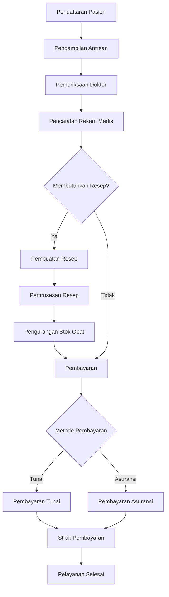

# Sistem Manajemen Klinik, Rekam Medis, dan Farmasi


## Deskripsi Proyek

Sistem Manajemen Klinik, Rekam Medis, dan Farmasi merupakan aplikasi berbasis Java yang dikembangkan untuk memenuhi tugas Project Based Learning (PJBL) mata kuliah Pemrograman Berorientasi Objek (PBO).

Aplikasi ini membantu mengelola pelayanan klinik mulai dari pendaftaran pasien, pengambilan antrean, pemeriksaan dokter, pencatatan rekam medis, pemrosesan resep, pengelolaan stok obat, hingga pembayaran.

Pada Versi 3, sistem dikembangkan dengan menambahkan validasi aturan bisnis, integrasi antarfitur, menu interaktif, serta pengujian untuk memastikan sistem berjalan sesuai kebutuhan.

## Tujuan Pengembangan

- Menerapkan konsep Pemrograman Berorientasi Objek menggunakan Java.
- Mengintegrasikan pelayanan klinik dengan sistem farmasi.
- Menerapkan validasi aturan bisnis.
- Meningkatkan keandalan sistem melalui pengujian.
- Menerapkan kolaborasi pengembangan perangkat lunak menggunakan Git dan GitHub.

## Fitur Utama

### 1. Manajemen Pasien dan Antrean

- Pendaftaran pasien.
- Validasi data pasien.
- Pencegahan nomor rekam medis duplikat.
- Pengambilan nomor antrean.
- Pencegahan antrean aktif ganda.
- Pemantauan status antrean.

### 2. Pemeriksaan dan Rekam Medis

- Pencatatan keluhan pasien.
- Pencatatan diagnosis dokter.
- Pembuatan rekam medis.
- Pembuatan resep obat.
- Pemeriksaan pasien tanpa resep.
- Pencegahan pemeriksaan ulang pada antrean yang sudah diperiksa.

### 3. Manajemen Farmasi

- Menampilkan daftar obat.
- Menampilkan stok dan harga obat.
- Pemrosesan resep.
- Validasi ketersediaan stok.
- Pengurangan stok berdasarkan resep.
- Penambahan stok obat.
- Pencegahan pemrosesan resep berulang.
- Pencegahan pengurangan stok sebagian ketika salah satu item resep tidak mencukupi.

### 4. Sistem Pembayaran

- Perhitungan biaya dokter.
- Perhitungan biaya obat.
- Pembayaran tunai.
- Pembayaran asuransi.
- Perhitungan uang kembalian.
- Pencetakan struk pembayaran.
- Pencegahan pembayaran ganda.

## Penerapan Konsep OOP

### Encapsulation

Atribut pada class dilindungi menggunakan access modifier private. Akses dan perubahan data dilakukan melalui method yang telah disediakan dengan menerapkan validasi sesuai aturan bisnis.

### Inheritance

Class Pengguna digunakan sebagai dasar pewarisan bagi class Dokter, Resepsionis, dan Apoteker.

### Abstraction

Abstract class Pengguna digunakan untuk merepresentasikan karakteristik umum pengguna sistem.

### Polymorphism

Interface Pembayaran diimplementasikan oleh class BayarTunai dan BayarAsuransi sehingga sistem dapat menggunakan metode pembayaran yang berbeda melalui tipe interface yang sama.

### Interface

Interface yang digunakan dalam pengembangan sistem antara lain:

- Pembayaran
- Notifikasi
- KlinikRepository

Penggunaan interface membantu memisahkan kontrak perilaku dengan implementasinya sehingga sistem lebih mudah dikembangkan dan dipelihara.

## Struktur Project

```text
PBO-PJBL/
├── README.md
├── .gitignore
└── PJBL/
    ├── pom.xml
    └── src/
        └── main/
            └── java/
                └── id/ac/untidar/klinik/
                    ├── model/
                    ├── payment/
                    ├── repository/
                    ├── service/
                    ├── test/
                    └── ui/
```

Keterangan package:

- model: menyimpan class yang merepresentasikan entitas sistem.
- payment: menangani metode pembayaran.
- repository: menangani penyimpanan dan pengambilan data.
- service: menangani logika bisnis klinik dan farmasi.
- test: menyimpan class pengujian sistem.
- ui: menangani tampilan dan interaksi pengguna.

## Teknologi yang Digunakan

- Java
- Apache NetBeans IDE
- Apache Maven
- Git
- GitHub

## Cara Menjalankan Aplikasi

Clone repository menggunakan perintah berikut:

```bash
git clone https://github.com/manggalaayudha/PBO-PJBL.git
```

Kemudian:

1. Buka Apache NetBeans IDE.
2. Pilih File > Open Project.
3. Buka folder PJBL di dalam repository PBO-PJBL.
4. Pastikan JDK yang digunakan sesuai dengan konfigurasi pom.xml.
5. Klik kanan pada project dan pilih Clean and Build.
6. Jalankan project atau file App.java.

Main class:

```text
id.ac.untidar.klinik.ui.App
```

## Menu Aplikasi

```text
========================================
   SISTEM MANAJEMEN KLINIK & FARMASI V3
========================================
1. Pendaftaran pasien
2. Ambil antrean
3. Daftar antrean
4. Pemeriksaan dokter
5. Pemrosesan resep
6. Daftar stok obat
7. Tambah stok obat
8. Pembayaran
0. Keluar
```

## Alur Penggunaan Sistem



## Pengujian Sistem

Pengujian dilakukan menggunakan dua class pengujian yang dapat dijalankan secara langsung melalui method main.

### KlinikServiceTest.java

Skenario pengujian:

- Pendaftaran pasien.
- Nomor rekam medis duplikat.
- Nama pasien kosong.
- Pembuatan antrean.
- Antrean ganda.
- Pembayaran tunai dengan uang mencukupi.
- Pembayaran tunai dengan uang tidak mencukupi.

Hasil pengujian setelah perbaikan:

```text
PASS: 7 | FAIL: 0
BUILD SUCCESS
```

### FarmasiServiceTest.java

Skenario pengujian:

- Harga obat nol.
- Stok awal negatif.
- Jumlah item resep nol.
- Stok mencukupi.
- Stok tidak mencukupi.
- Resep diproses ulang.
- Stok tidak mencukupi pada item kedua.

Hasil pengujian setelah perbaikan:

```text
PASS: 7 | FAIL: 0
BUILD SUCCESS
```

### Perbandingan Hasil Pengujian

| Pengujian | PASS | FAIL | Keberhasilan |
|---|---:|---:|---:|
| Klinik sebelum perbaikan | 4 | 3 | 57,14% |
| Farmasi sebelum perbaikan | 5 | 2 | 71,43% |
| Total sebelum perbaikan | 9 | 5 | 64,29% |
| Klinik setelah perbaikan | 7 | 0 | 100% |
| Farmasi setelah perbaikan | 7 | 0 | 100% |
| Total setelah perbaikan | 14 | 0 | 100% |

Pengujian integrasi secara manual juga dilakukan untuk memastikan seluruh alur pelayanan dapat berjalan dari pendaftaran pasien hingga pembayaran dan pencetakan struk.

## Pembagian Tugas Anggota

| Anggota | Username GitHub | Tanggung Jawab |
|---|---|---|
| Anggota 1 | manggalaayudha | Testing, pengujian integrasi, dan koordinasi repository |
| Anggota 2 | gilangfastya | Validasi pasien dan antrean |
| Anggota 3 | maulanafatkhan | Validasi resep dan pengelolaan stok farmasi |
| Anggota 4 | indrasfn | Integrasi sistem dan menu interaktif |

## Kolaborasi GitHub

Pengembangan dilakukan menggunakan feature branch, commit, Pull Request, dan Code Review.

| Pull Request | Branch | Pengembangan |
|---|---|---|
| #1 | feature/pasien-antrean | Validasi pasien dan antrean |
| #2 | feature/farmasi | Validasi resep dan pengelolaan stok |
| #3 | feature/integration | Integrasi sistem dan menu interaktif |
| #4 | feature/testing | Pengujian sistem klinik dan farmasi |

Seluruh Pull Request pengembangan telah mendapatkan Code Review dari anggota tim dan berhasil digabungkan ke branch main.

## Keterbatasan Sistem

- Aplikasi masih menggunakan antarmuka berbasis console.
- Penyimpanan data menggunakan repository berbasis memori.
- Data tidak disimpan secara permanen ke database.
- Validasi polis asuransi masih berupa simulasi dan belum terhubung dengan penyedia asuransi sebenarnya.

## Informasi Proyek

- Mata Kuliah: Pemrograman Berorientasi Objek
- Jenis Proyek: Project Based Learning (PJBL)
- Universitas: Universitas Tidar
- Versi Pengembangan: V3
- Tahun: 2026# PBO-PJBL
